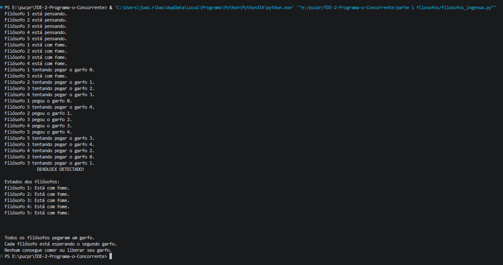
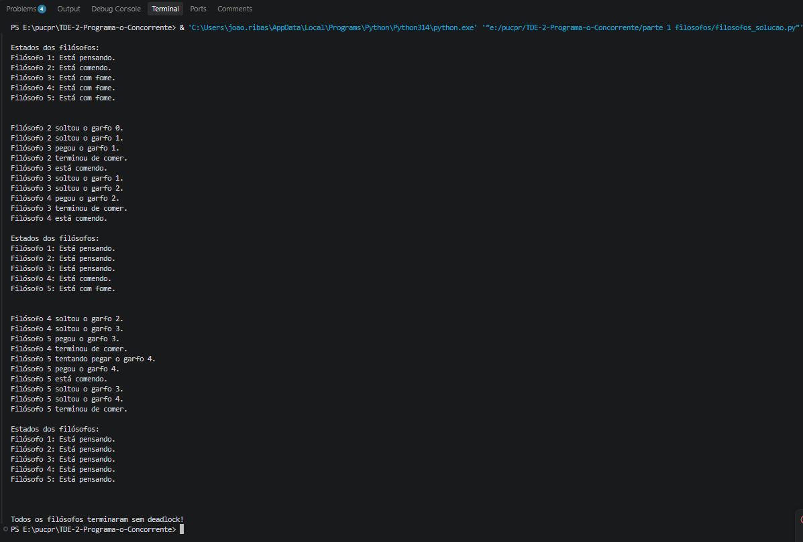

# Parte 1: Jantar dos Filósofos

## Descrição do problema

O problema consiste em cinco filósofos sentados em uma mesa, com um garfo entre cada um deles.

Cada filósofo pode pensar ou comer, mas para comer precisa pegar os dois garfos ao seu lado.

O problema acontece quando todos tentam pegar os garfos ao mesmo tempo, podendo ficar esperando uns pelos outros e travar a execução.

O objetivo é encontrar uma forma de evitar esse travamento.

## Versão ingênua

Na primeira versão, todos os filósofos tentam pegar primeiro o garfo direito e depois o esquerdo.

Cada filósofo é representado por uma thread e cada garfo por um Lock, que impede que dois filósofos utilizem o mesmo garfo ao mesmo tempo.

Utilizamos uma barreira para fazer todos pegarem o primeiro garfo antes de tentar pegar o segundo.

Com isso, todos ficam segurando um garfo e esperando o outro, causando um **deadlock**, pois ninguém consegue continuar.

## Versão corrigida

Na segunda versão, utilizamos uma solução simples: fazer o último filósofo pegar os garfos na ordem contrária.

Enquanto os quatro primeiros pegam o garfo direito antes do esquerdo, o último tenta pegar primeiro o esquerdo e depois o direito.

Também retiramos a barreira da primeira versão.

Essa mudança quebra a espera circular, permitindo que os filósofos consigam comer e liberar os garfos.

## Condições de Coffman

Existem quatro condições necessárias para acontecer um deadlock:

- Exclusão mútua: um garfo só pode ser usado por um filósofo de cada vez.
- Manter e esperar: um filósofo segura um garfo enquanto espera outro.
- Não preempção: um filósofo não pode tirar o garfo de outro.
- Espera circular: cada filósofo espera um garfo que está com outro.

Na versão corrigida, eliminamos a **espera circular**, fazendo o último filósofo pegar os garfos em uma ordem diferente.

## Progresso e justiça

Na versão ingênua, os filósofos ficam travados e não conseguem comer.

Na versão corrigida, eles conseguem continuar a execução e terminar seus ciclos.

Porém, essa solução não garante totalmente que todos terão a mesma oportunidade de comer, já que um filósofo ainda pode esperar mais que os outros.

## Protocolo utilizado

Versão ingênua:

1. O filósofo começa pensando.
2. Fica com fome.
3. Pega o garfo direito.
4. Espera os outros pegarem o primeiro garfo.
5. Tenta pegar o esquerdo.
6. Ocorre deadlock.

Versão corrigida:

1. O filósofo começa pensando.
2. Fica com fome.
3. Os quatro primeiros tentam pegar o direito e depois o esquerdo.
4. O último tenta pegar o esquerdo e depois o direito.
5. Quando consegue os dois garfos, começa a comer.
6. Termina de comer e libera os garfos.
7. Volta a pensar.

## Como executar

O projeto foi desenvolvido em Python, utilizando as bibliotecas threading e time.

É necessário ter o Python 3 instalado. Não é preciso instalar outras bibliotecas nem compilar o código.

Para executar, abra o terminal na pasta do projeto.

Versão ingênua:

python versao_ingenua.py

Versão corrigida:

python versao_corrigida.py

## Resultados

Versão ingênua:

Na execução, todos os filósofos conseguem pegar o primeiro garfo, mas ficam esperando o segundo. O programa identifica o deadlock.

**Versão corrigida:**

Na segunda versão, os filósofos conseguem pegar os garfos, comer e terminar seus ciclos sem deadlock.

## Conclusão

Com a atividade, conseguimos observar como o uso de recursos compartilhados pode causar deadlock.

Na primeira versão, todos os filósofos ficaram travados tentando pegar os garfos. Na segunda, mudamos a ordem em que o último filósofo pega os garfos, evitando o problema.

Assim, conseguimos entender melhor o funcionamento das threads, dos Locks e da espera circular.

## Fonte para a solução

https://www.youtube.com/watch?v=g9zEqwSZd4o